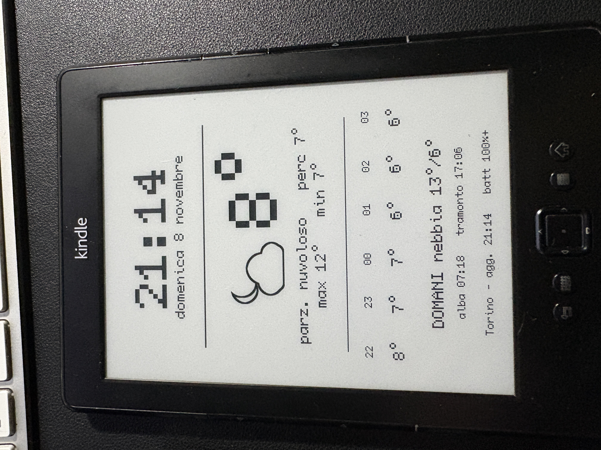
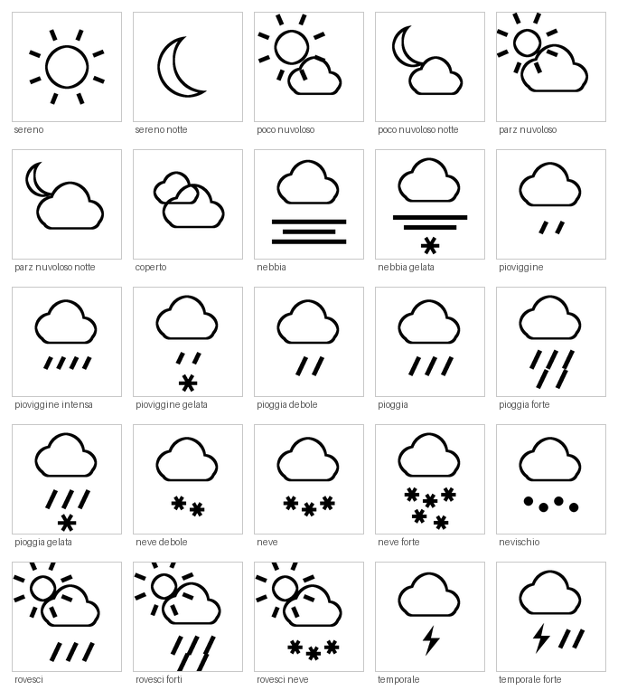

# Centralina meteo per Kindle 4

Un Kindle 4 Non-Touch del 2011 trasformato in pannello meteo da muro. Ora e
data aggiornate al minuto, temperatura attuale con percepita e min/max del
giorno, le sei ore successive e la previsione di domani con alba e tramonto.

**Tutto gira a bordo del Kindle.** Nessun server, nessun Raspberry Pi, nessun
hosting: il dispositivo scarica i dati da Open-Meteo in HTTPS e disegna il
pannello da sé. Gli servono solo corrente e Wi-Fi.

*[Read in English](README.md)*



---

## Perché questo progetto

Il Kindle 4 Non-Touch è il modello meno documentato della famiglia. Quasi tutti
i progetti Kindle degli ultimi dieci anni presuppongono un firmware 5.x con
touch, e un consiglio scritto per un Paperwhite o un DXG di solito qui non
vale.

Dal maggio 2026 il K4 è anche fuori supporto: non può più comprare dallo store
Amazon, e un reset di fabbrica lo lascia impossibilitato a registrarsi di
nuovo. Un dispositivo che non può più fare il suo mestiere originale è un buon
candidato per un secondo.

La parte difficile non è stata il jailbreak, ma il TLS.

---

## Il problema del TLS, e come si risolve

Il K4 monta `curl` 7.21.4 compilato contro **OpenSSL 0.9.8j**, del 2008.
Arriva al massimo a TLS 1.0, che qualunque API moderna rifiuta:

```
error:1407742E:SSL routines:SSL23_GET_SERVER_HELLO:tlsv1 alert protocol version
```

Il browser sperimentale non va meglio: il suo WebKit è del 2011, e nel
frattempo l'intero web è passato a HTTPS. Le pagine in `http://` in chiaro si
aprono ancora, ma non le serve quasi più nessuno.

La via d'uscita è il **pacchetto Python per Kindle di NiLuJe**, che porta con
sé Python 2.7.10 con **OpenSSL 1.0.2d**, che parla TLS 1.2:

```
$ python -c "import ssl; print(ssl.OPENSSL_VERSION)"
OpenSSL 1.0.2d 9 Jul 2015
```

Da lì il dispositivo raggiunge Open-Meteo direttamente, e Python legge il JSON
nativamente, senza parsing acrobatico da shell.

Da notare che puntare `LD_LIBRARY_PATH` a una `libssl` più recente **non** aiuta
il `curl` di sistema: è linkato a `libssl.so.0.9.8` per nome, quindi una
`libssl.so.1.0.0` che gli sta accanto non viene nemmeno presa in
considerazione.

---

## Cosa serve

| | |
|---|---|
| Dispositivo | Kindle 4 Non-Touch (D01100), firmware 4.0.0–4.1.4 |
| Computer | Uno qualsiasi, per il collegamento USB e il trasferimento file |
| Alimentazione | Una presa vicino a dove starà il pannello |
| Rete | Wi-Fi |

Il K4 **non ha retroilluminazione**, quindi serve un punto con luce ambientale.

Lo schermo è 600 × 800 px, 6", 167 ppi, 16 livelli di grigio, senza touch. Il
kernel è Linux 2.6.31 su armv7l.

---

## Componenti

| Pezzo | Ruolo |
|---|---|
| [Jailbreak K4](https://www.mobileread.com/forums/showthread.php?t=191158) | Sblocca il dispositivo e permette di installare pacchetti non firmati |
| [USBNetwork](https://www.mobileread.com/forums/showthread.php?t=88004) | SSH attraverso il cavo USB, per installazione e manutenzione |
| [Kindle Python](https://www.mobileread.com/forums/showthread.php?t=88004) (stesso thread) | Python 2.7.10 con OpenSSL 1.0.2d — è quello che rende possibile l'HTTPS |
| [FBInk](https://www.mobileread.com/forums/showthread.php?t=299620) | Disegna testo scalabile e immagini PNG sul framebuffer e-ink |
| [Open-Meteo](https://open-meteo.com/) | I dati meteo, gratuiti e senza chiave API |

Tutti e quattro i pacchetti Kindle vengono dai thread di NiLuJe su MobileRead.
**Per scaricare gli allegati serve un account del forum**, gratuito.

> **FBInk:** il repository GitHub contiene solo il sorgente. I binari
> precompilati sono nell'allegato `FBInk-vX.Y.Z-kindle.tar.gz` del thread
> MobileRead — occhio al suffisso `-kindle`. Va usata la cartella **K3**, che è
> la build giusta anche per il K4.

---

## Installazione

La procedura completa, dal jailbreak al pannello funzionante, è in
**[docs/INSTALL.it.md](docs/INSTALL.it.md)**.

In breve, una volta sbloccato il dispositivo e installati Python e FBInk:

```sh
# sul Kindle, via SSH
mkdir -p /mnt/us/meteo
# copiare li' meteo.py, ora.py e la cartella icone/, poi:
python /mnt/us/meteo/meteo.py
```

Per la propria località si modificano `LAT`, `LON` e `FUSO` in cima a
`meteo.py`.

---

## Come funziona

### Due script, due ritmi

`meteo.py` scarica i dati e disegna tutto il pannello. `ora.py` ridisegna solo
l'orologio e la data.

Ridisegnare tutto ogni minuto significherebbe sessanta chiamate all'API ogni
ora e altrettanti refresh e-ink a schermo intero. Quindi `meteo.py` gira ogni
dieci minuti e `ora.py` ogni minuto, astenendosi sui multipli di dieci perché i
due non si pestino i piedi.

`ora.py` ridisegna **sia** l'orologio **sia** la data: la cella del carattere a
dimensione 14 è abbastanza alta da mordere il bordo superiore della data
sottostante, quindi deve riscriverla subito dopo.

### Il fuso orario

Il Kindle vive in UTC, e il suo fuso di sistema è meglio non toccarlo: il
framework Amazon tende a risovrascrivere l'impostazione.

I dati vengono invece chiesti a Open-Meteo già nel fuso desiderato, e l'API
restituisce lo scostamento in secondi. `meteo.py` lo salva in `fuso.txt`, e
`ora.py` lo usa per ricavare l'ora locale dall'orologio di sistema.

Effetto collaterale gradito: **il cambio tra ora legale e solare si aggiusta da
solo**, due volte l'anno, senza interventi.

L'orologio a schermo usa l'ora di **sistema** e non quella contenuta nella
risposta dell'API: Open-Meteo arrotonda `current.time` al quarto d'ora, e il
pannello mostrerebbe un orario arretrato. L'ora dell'API serve solo ad
agganciare la serie oraria delle previsioni.

### Le icone

Venticinque PNG in bianco e nero, 130 × 130 px. Una per ogni codice meteo WMO,
più le varianti notturne con la luna per sereno, poco nuvoloso e parzialmente
nuvoloso: lo script chiede a Open-Meteo anche `is_day` e sceglie di
conseguenza.



Le genera `tools/genera_icone.py` su un computer (Python 3 e Pillow). Sono
disegnate a quattro volte la dimensione finale e poi ridotte: su e-ink i bordi
curvi devono essere netti, e il sovracampionamento è l'unico modo per
ottenerli. Ogni forma viene tracciata piena e il contorno si ricava per
erosione, così l'unione di più cerchi produce una sagoma sola, senza linee
interne da ripulire.

Prima di salvarle, ciascuna icona viene ritagliata al suo contenuto e
riscalata. Senza quel passaggio un sole tondo e una nuvola con la pioggia hanno
margini interni diversi e sembrano di dimensioni diverse accanto alla
temperatura.

### Il posizionamento

FBInk dispone il testo su una griglia di caratteri. A dimensione 14 una cella è
larga oltre cento pixel: troppo per affiancare un'icona a un numero. L'opzione
`-X` aggiunge un offset in pixel alla cella, e dà la precisione che serve.

**Solo in orizzontale.** Le posizioni verticali del pannello sono tarate
sull'arrotondamento per righe, e passare al pixel anche in verticale fa
slittare tutte le bande verso il basso.

Il centraggio si calcola sulla larghezza **visibile**, non sulle celle
occupate: il simbolo `°` ha una cella sua ma ne disegna poco più di metà, e
centrando sulle celle il blocco risulta spostato a sinistra. Il parametro
`GRADO_LARG` regola quella correzione.

---

## Alimentazione

Con la Wi-Fi sempre accesa il dispositivo non arriva a sera: la radio consuma
molto più dello schermo, e un `ora.py` al minuto sveglia la CPU sessanta volte
l'ora, impedendo qualunque sonno profondo.

La soluzione adottata è una **presa smart con fasce orarie**, con il software
allineato a quelle. Il pannello lavora solo nelle ore in cui c'è corrente,
quindi la batteria non viene quasi mai usata — cosa che conta su una cella di
quindici anni, dove i cicli di scarica profonda quotidiani fanno più danno
della carica mantenuta che la presa doveva evitare.

Esempio di pianificazione, da adattare alle ore in cui si guarda davvero il
pannello:

```
*/10 5-8,17-23 * * * /usr/bin/python /mnt/us/meteo/meteo.py >/dev/null 2>&1
*    5-8,17-23 * * * /usr/bin/python /mnt/us/meteo/ora.py   >/dev/null 2>&1
55 4,16 * * * lipc-set-prop com.lab126.cmd wirelessEnable 1
1  9    * * * lipc-set-prop com.lab126.cmd wirelessEnable 0
25 23   * * * lipc-set-prop com.lab126.cmd wirelessEnable 0
```

La Wi-Fi si accende cinque minuti prima di ogni finestra, perché la connessione
faccia in tempo a stabilirsi prima del primo scaricamento.

I percorsi nel cron devono essere **assoluti**: cron non carica il profilo
della shell, quindi né `fbink` né `python` vengono trovati per nome. Per questo
`meteo.py` ha la costante `FBINK` in cima.

`meteo.py` rimette `preventScreenSaver` a ogni esecuzione, quindi non serve uno
script d'avvio: dopo un riavvio lo screensaver resta attivo al massimo dieci
minuti, poi si sistema da sé.

Se la rete non risponde, lo script esce senza toccare lo schermo: resta
l'ultimo pannello buono invece di una pagina bianca.

### Lo storico della batteria

Ogni esecuzione di `meteo.py` aggiunge una riga a `batteria.log` con data,
percentuale e stato di carica. Serve a verificare con i numeri se le proprie
fasce reggono davvero:

```sh
cat /mnt/us/meteo/batteria.log
```

---

## Personalizzare il pannello

Tutte le posizioni stanno in cima a `meteo.py`, sotto la riga `REGOLAZIONI`, ed
sono espresse in **pixel dall'alto** su uno schermo alto 800. Ogni banda è una
coppia: dimensione del carattere e altezza. Le linee separatrici sono altezza e
spessore.

Due cose da sapere prima di spostare qualcosa:

- FBInk posiziona il testo su una **griglia di celle**. Lo script misura
  l'altezza della cella per ogni dimensione interrogando FBInk stesso, poi
  converte i pixel in righe. L'arrotondamento può spostare una banda di qualche
  pixel.
- Scrivere una banda **cancella lo sfondo della sua cella**. Due bande troppo
  vicine si mangiano a vicenda: è il motivo per cui `ora.py` deve ridisegnare
  anche la data.

Il font si cambia in un posto solo, la costante `FONT`. Oltre a `ORP` ci sono
`TERMINUS`, `SPLEEN`, `COZETTE`, `TOPAZ`, `LEGGIE`, `SCIENTIFICA`, `FATTY` e
`TEWI`.

Attenzione alla larghezza delle righe: a dimensione 3 ci stanno circa
venticinque caratteri. Una riga più lunga va a capo e sborda sulla banda sotto.

---

## Quando qualcosa non va

In **[docs/TROUBLESHOOTING.it.md](docs/TROUBLESHOOTING.it.md)** c'è la tabella
di ogni punto in cui questo progetto si è bloccato, con la soluzione.

---

## Avvertenze

> **Non fare mai un reset di fabbrica su un Kindle 4.** Dal 20 maggio 2026 un
> K4 resettato o deregistrato non può più essere registrato. Per nulla di
> quanto descritto qui serve un reset.

> **Fare il backup prima di cominciare.** Appena si ha l'SSH, conviene prendere
> un'immagine completa della memoria interna. Se qualcosa va storto,
> [Kubrick](https://www.mobileread.com/forums/showthread.php?t=206064) è una
> live CD Linux fatta apposta per recuperare un K4.

> **Il numero di serie è un dato sensibile.** La password di root si ricava da
> lì: meglio non pubblicare foto che lo mostrino.

---

## Limiti noti

- Le icone *poco nuvoloso* e *parzialmente nuvoloso* si somigliano molto:
  cambia solo quanto il sole è coperto.
- Le varianti "gelata" sono marcate con un asterisco sotto le gocce. È una
  convenzione, non è immediata.
- I commenti nel codice sono in italiano. La documentazione copre tutto quello
  che serve per lavorarci.

---

## Riconoscimenti

Costruito sul lavoro di **[NiLuJe](https://github.com/NiLuJe)**, i cui pacchetti
jailbreak, USBNetwork, Python e FBInk rendono possibile tutto questo, e su anni
di conoscenza accumulata nei forum
[MobileRead](https://wiki.mobileread.com/wiki/Kindle4NTHacking).

Dati meteo da [Open-Meteo](https://open-meteo.com/), gratuiti e senza chiave
API.

---

## Licenza

GPL-3.0. Vedi [LICENSE](LICENSE).
