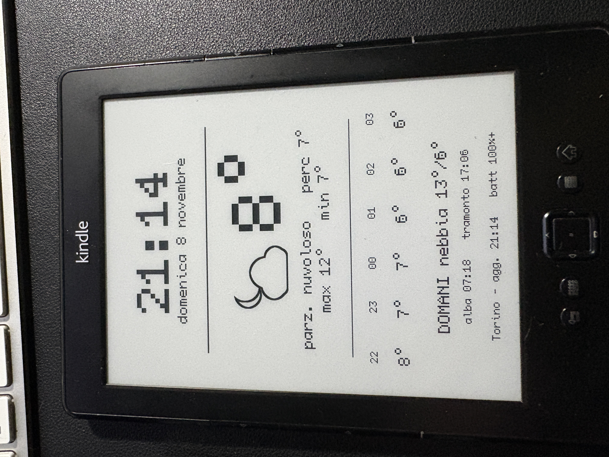
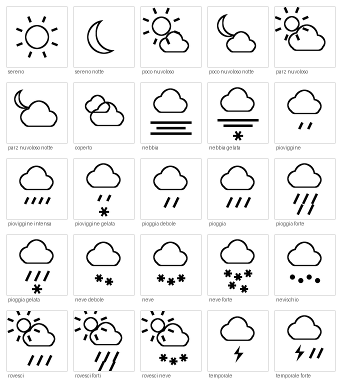

# Kindle 4 Weather Station

A 2011 Kindle 4 Non-Touch turned into a wall-mounted weather panel. Clock and
date updated every minute, current temperature with feels-like and daily
min/max, the next six hours, and tomorrow's forecast with sunrise and sunset.

**Everything runs on the Kindle itself.** No server, no Raspberry Pi, no
hosting: the device fetches data from Open-Meteo over HTTPS and draws the panel
on its own. All it needs is power and Wi-Fi.

*[Leggi in italiano](README.it.md)*



---

## Why this exists

The Kindle 4 Non-Touch is the least documented member of the family. Almost
every Kindle project from the last decade assumes a 5.x firmware with a
touchscreen, and advice written for a Paperwhite or a DXG usually does not
apply here.

The K4 also hit end of support in May 2026: it can no longer buy from the
Amazon store, and a factory reset leaves it unable to re-register. A device
that can't do its original job is a good candidate for a second one.

The hard part was not the jailbreak. It was TLS.

---

## The TLS problem, and how it was solved

The K4 ships `curl` 7.21.4 built against **OpenSSL 0.9.8j**, dated 2008. It
tops out at TLS 1.0, which every modern API refuses:

```
error:1407742E:SSL routines:SSL23_GET_SERVER_HELLO:tlsv1 alert protocol version
```

The experimental browser is no better — its WebKit is from 2011, and the whole
web has moved to HTTPS since. Plain `http://` pages still load, but almost
nothing serves them any more.

The way through is **NiLuJe's Python package for Kindle**. It bundles Python
2.7.10 with **OpenSSL 1.0.2d**, which speaks TLS 1.2:

```
$ python -c "import ssl; print(ssl.OPENSSL_VERSION)"
OpenSSL 1.0.2d 9 Jul 2015
```

From there the device reaches Open-Meteo directly, and Python parses the JSON
natively — no shell-based parsing needed.

Note that `LD_LIBRARY_PATH` pointing at a newer `libssl` does **not** help the
system `curl`: it links against `libssl.so.0.9.8` by name, so a
`libssl.so.1.0.0` sitting next to it is simply never considered.

---

## What you need

| | |
|---|---|
| Device | Kindle 4 Non-Touch (D01100), firmware 4.0.0–4.1.4 |
| Computer | Any, for the USB connection and file transfer |
| Power | A mains socket near where the panel will hang |
| Network | Wi-Fi |

The K4 has **no front light**, so pick a spot with ambient light.

Screen is 600 × 800 px, 6", 167 ppi, 16 grey levels, no touch. Kernel is Linux
2.6.31 on armv7l.

---

## Components

| Piece | Role |
|---|---|
| [K4 jailbreak](https://www.mobileread.com/forums/showthread.php?t=191158) | Unlocks the device so unsigned packages can be installed |
| [USBNetwork](https://www.mobileread.com/forums/showthread.php?t=88004) | SSH over the USB cable, for setup and maintenance |
| [Kindle Python](https://www.mobileread.com/forums/showthread.php?t=88004) (same thread) | Python 2.7.10 with OpenSSL 1.0.2d — this is what makes HTTPS work |
| [FBInk](https://www.mobileread.com/forums/showthread.php?t=299620) | Draws scalable text and PNG images on the e-ink framebuffer |
| [Open-Meteo](https://open-meteo.com/) | Weather data, free, no API key |

All four Kindle packages come from NiLuJe's threads on MobileRead. **Download
attachments require a (free) forum account.**

> **FBInk:** the GitHub repository holds source only. The precompiled binaries
> are the `FBInk-vX.Y.Z-kindle.tar.gz` attachment in the MobileRead thread —
> note the `-kindle` suffix. Use the **K3** folder; it is the right build for
> the K4.

---

## Installation

See **[docs/INSTALL.md](docs/INSTALL.md)** for the full walkthrough, from
jailbreak to running panel.

Short version, once the device is jailbroken and Python + FBInk are installed:

```sh
# on the Kindle, over SSH
mkdir -p /mnt/us/meteo
# copy meteo.py, ora.py and the icone/ folder there, then:
python /mnt/us/meteo/meteo.py
```

Edit `LAT`, `LON` and `FUSO` at the top of `meteo.py` for your location.

---

## How it works

### Two scripts, two rhythms

`meteo.py` fetches the data and draws the whole panel. `ora.py` redraws only
the clock and the date.

Redrawing everything every minute would mean sixty API calls an hour and sixty
full-screen e-ink refreshes. So `meteo.py` runs every ten minutes and `ora.py`
every minute, standing aside on the multiples of ten so the two never collide.

`ora.py` redraws **both** the clock and the date: the character cell at size 14
is tall enough to clip the top of the date underneath it, so it has to rewrite
that line immediately after.

### Time zone

The Kindle lives in UTC, and its system time zone is best left alone — the
Amazon framework tends to overwrite the setting.

Instead, the data is requested from Open-Meteo already in the target time zone,
and the API returns the offset in seconds. `meteo.py` saves it to `fuso.txt`,
and `ora.py` uses it to work out local time from the system clock.

A welcome side effect: **the DST switch handles itself**, twice a year, with no
intervention.

The on-screen clock uses the **system** time rather than the timestamp in the
API response: Open-Meteo rounds `current.time` to the quarter hour, which would
leave the panel showing a stale time. The API timestamp is used only to line up
the hourly forecast series.

### The icons

Twenty-five black-and-white PNGs, 130 × 130 px. One per WMO weather code, plus
night variants with a moon for clear, mostly clear and partly cloudy — the
script asks Open-Meteo for `is_day` and picks accordingly.



`tools/genera_icone.py` generates them on a desktop machine (Python 3 +
Pillow). They are drawn at four times the final size and downscaled: e-ink
needs crisp curved edges, and supersampling is the only way to get them. Each
shape is drawn filled and its outline derived by erosion, so a union of circles
yields a single silhouette with no internal lines to clean up.

Before saving, each icon is cropped to its content and rescaled. Without that
step a round sun and a cloud-with-rain have different internal margins and look
like different sizes next to the temperature.

### Positioning

FBInk places text on a character grid. At size 14 a cell is over a hundred
pixels wide — far too coarse to sit an icon next to a number. The `-X` option
adds a pixel offset on top of the cell, which gives the precision needed.

**Horizontally only.** The panel's vertical positions are calibrated against
row rounding, and switching the vertical axis to pixels shifts every band
downward.

Centring is computed on the **visible** width, not the cells occupied: the `°`
symbol gets a cell of its own but draws a little over half of it, so centring
on cells leaves the block looking shifted left. `GRADO_LARG` tunes that
correction.

---

## Power

With Wi-Fi permanently on, the device does not last a day: the radio draws far
more than the screen, and a per-minute `ora.py` wakes the CPU sixty times an
hour, preventing any deep sleep.

The approach here is a **smart plug on a schedule**, with the software aligned
to it. The panel works only during the hours when power is available, so the
battery is barely used at all — which matters on a fifteen-year-old cell, where
daily deep discharge cycles do more harm than the trickle charging the plug was
meant to avoid.

Example schedule (adjust to when you actually look at the panel):

```
*/10 5-8,17-23 * * * /usr/bin/python /mnt/us/meteo/meteo.py >/dev/null 2>&1
*    5-8,17-23 * * * /usr/bin/python /mnt/us/meteo/ora.py   >/dev/null 2>&1
55 4,16 * * * lipc-set-prop com.lab126.cmd wirelessEnable 1
1  9    * * * lipc-set-prop com.lab126.cmd wirelessEnable 0
25 23   * * * lipc-set-prop com.lab126.cmd wirelessEnable 0
```

Wi-Fi comes up five minutes before each window so the connection has time to
settle before the first fetch.

Paths in cron must be **absolute**: cron does not load the shell profile, so
neither `fbink` nor `python` is found by name. That is why `meteo.py` has a
`FBINK` constant at the top.

`meteo.py` re-applies `preventScreenSaver` on every run, so no startup script
is needed — after a reboot the screensaver stays active for ten minutes at
most, then sorts itself out.

If the network does not answer, the script exits without touching the screen:
the last good panel stays up instead of a blank page.

### Battery log

Every run of `meteo.py` appends a line to `batteria.log` with date, percentage
and charging state. Useful for checking with numbers whether your schedule
actually holds:

```sh
cat /mnt/us/meteo/batteria.log
```

---

## Customising the panel

All positions sit at the top of `meteo.py`, under `REGOLAZIONI`, expressed as
**pixels from the top** on an 800-pixel-tall screen. Each band is a pair:
character size and height. Separator lines are height and thickness.

Two things worth knowing before moving anything:

- FBInk positions text on a **grid of cells**. The script measures cell height
  for each size by asking FBInk itself, then converts pixels to rows. Rounding
  can shift a band by a few pixels.
- Writing a band **clears its cell background**. Two bands too close together
  will eat into each other — that is why `ora.py` has to redraw the date.

The font is set in one place, the `FONT` constant. Besides `ORP` there are
`TERMINUS`, `SPLEEN`, `COZETTE`, `TOPAZ`, `LEGGIE`, `SCIENTIFICA`, `FATTY` and
`TEWI`.

Watch line width: at size 3 roughly twenty-five characters fit. A longer line
wraps and spills into the band below.

---

## Troubleshooting

See **[docs/TROUBLESHOOTING.md](docs/TROUBLESHOOTING.md)** — a table of every
place this project got stuck, with the fix.

---

## Warnings

> **Never factory reset a Kindle 4.** Since 20 May 2026, a reset or deregistered
> K4 can no longer be registered. You do not need a reset for any of this.

> **Back up before you start.** Once you have SSH, take a full image of the
> internal memory. If something goes wrong,
> [Kubrick](https://www.mobileread.com/forums/showthread.php?t=206064) is a
> Linux live CD built specifically to unbrick the K4.

> **Serial numbers are sensitive.** The root password is derived from the
> device serial. Don't post photos showing it.

---

## Known limitations

- *Mostly clear* and *partly cloudy* icons look very similar — only the amount
  of sun covered differs.
- The "freezing" variants are marked with an asterisk below the drops. It's a
  convention, not immediately obvious.
- Code comments are in Italian. The documentation covers everything needed to
  work with it.

---

## Credits

Built on the work of **[NiLuJe](https://github.com/NiLuJe)**, whose jailbreak,
USBNetwork, Python and FBInk packages make everything here possible, and on
years of accumulated knowledge in the
[MobileRead](https://wiki.mobileread.com/wiki/Kindle4NTHacking) forums.

Weather data from [Open-Meteo](https://open-meteo.com/), free and without an
API key.

---

## Licence

GPL-3.0. See [LICENSE](LICENSE).
